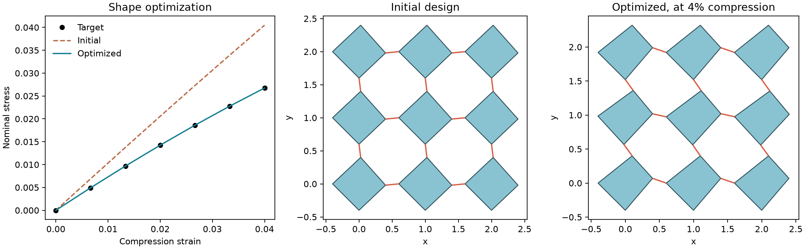
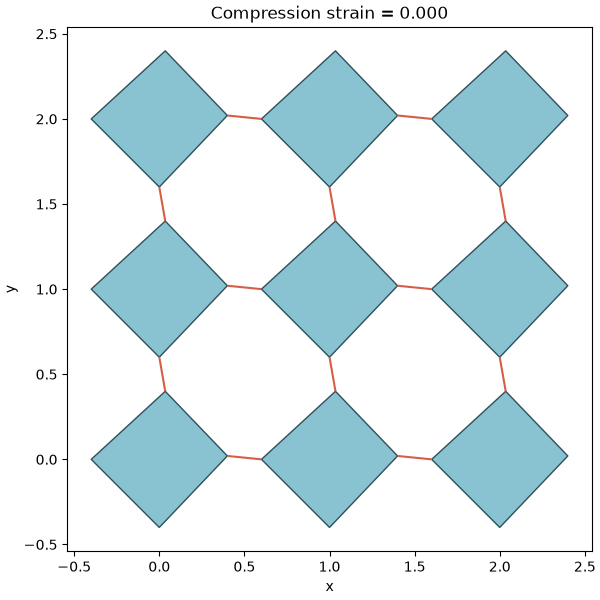

# Rotating Polygons Optimization

Differentiable simulation and shape optimization of two-dimensional rotating
polygon metamaterials, written in Python with JAX.

Define the **geometry → prescribed degrees of freedom → initialization →
material and potential → solver → objective and restrictions → optimization**.
Each part is a separate module and can be replaced without rewriting the others.

The default model uses rigid polygons connected by finite-length elastic hinges:
stretching, endpoint-angle shear, relative-rotation bending, and local angular
contact. Quasistatic compression uses BFGS or L-BFGS; velocity-Verlet dynamics
supports prescribed motion, inertia, damping, and external forces.

## Install

Python 3.11 or newer. From this directory:

```bash
python -m venv .venv
source .venv/bin/activate
python -m pip install -e ".[notebook,dev]"
```

For simulation only, use `pip install .`. Plotting is optional: `pip install
".[plot]"`. These commands install CPU JAX; accelerator installations should
follow the [JAX installation guide](https://docs.jax.dev/en/latest/installation.html).
The package does not select a device or change JAX precision on import.
Examples explicitly enable 64-bit arithmetic for reliable tight equilibrium
tolerances.

For NLopt optimization and video export, install the optional extras:

```bash
python -m pip install -e ".[notebook,nlopt,video]"
```

GIF export uses Pillow. MP4 export additionally requires the `ffmpeg` executable
on your system; if it is unavailable, `save_video` can export a GIF instead and
returns the actual saved path.

## Start with stress–strain matching

```bash
python examples/optimize_square_grid.py --output outputs
jupyter lab examples/01_optimize_square_grid.ipynb
```

The example starts from a 3×3 grid of squares with small deterministic shape
perturbations. It optimizes two repeated vertex offsets to fit an attainable
synthetic nominal stress–strain curve, subject to bounds, minimum edge and
ligament lengths, and convex-corner restrictions. Geometry is generated in
Python; no legacy files or parent-directory imports are required.

The notebook walks through every stage. The Python example also writes a plot
and numeric `.npz` results. Replace the synthetic target with your desired or
measured curve, and replace the two-parameter shape map with independent vertex
offsets or another parameterization. Multiple shapes can fit the same curve;
this example demonstrates response matching, not unique shape recovery.

## Learn to change the system and optimization

The [worked-example guide](examples/README.md) explains how to select state
coordinates, design variables, and solver settings. Continue with:

- [Boundary conditions](examples/02_boundary_conditions.ipynb): clamped/sliding
  grips, one fixed polygon coordinate, a prescribed angle, and shear loading.
- [Different objectives](examples/03_optimization_objectives.ipynb): target a
  secant stiffness or distribute support forces uniformly under a load requirement.
- [Spring constants](examples/04_optimize_spring_constants.ipynb): optimize
  shared or grouped axial constants and rotational bending constants while
  holding geometry fixed.
- [Independent vertices](examples/05_optimize_all_vertices.ipynb): optimize
  all 36 vertices of a 3×3 grid with 72 independent x/y offsets, including
  vertices on the grip polygons.

```bash
python examples/boundary_conditions.py --output outputs/boundaries
python examples/optimize_objectives.py --objective all --output outputs
python examples/optimize_spring_constants.py --parameterization all --output outputs
python examples/optimize_all_vertices.py --output outputs
```



The fifth tutorial explains the geometry and parameter indexing with this
diagram. The offsets change the local polygon shapes; the equilibrium solver
then translates and rotates those rigid shapes under the prescribed loading.


The drawing is also available as a [PNG](docs/assets/vertex_design_setup.png).
Generate both formats with `python examples/draw_vertex_design.py`.

## A minimal simulation

```python
import jax
import jax.numpy as jnp
from rotating_polygons import (
    square_grid, compression_boundary, initialize,
    PotentialParameters, make_potential, make_quasistatic_solver,
    make_stress_measurement,
)

jax.config.update("jax_enable_x64", True)
geometry = square_grid(3, 3, hinge_gap=0.2)
boundary = compression_boundary(geometry)
reference = initialize(geometry)
potential = make_potential(
    geometry,
    PotentialParameters(stretching=1.0, shearing=0.1, bending=0.02),
)
simulate = make_quasistatic_solver(geometry, boundary, potential)
strain = jnp.linspace(0.0, 0.04, 7)
solution = simulate(reference, strain).check_convergence()
stress = make_stress_measurement(potential, boundary)(solution.states, reference)
```

Positive strain means compression. Strain uses the distance between grip
centers. Nominal stress is compressive reaction divided by reference width and
thickness; the default thickness is one. `reaction_forces` provides the
un-normalized forces and torques.

## Time integration

```bash
python examples/verlet_compression.py --output outputs
```

`make_verlet_solver` accepts the same geometry, boundary, reference, and potential
as the quasistatic solver. It additionally needs masses, rotational inertias, a
timestep, and optionally damping. The example uses a smooth compression ramp
followed by a hold. Dynamics and quasistatic equilibria need not give the same
response; check timestep convergence and loading-rate effects.

## Export a simulation video

Use the same function for quasistatic and Verlet trajectories. Pass the
candidate's local vertices when visualizing an optimized shape:

```python
from rotating_polygons import save_video

video_path = save_video(
    geometry,
    solution.states,
    "outputs/compression.mp4",
    vertices=reference.vertices,
    fps=20,
    stride=1,  # Show every saved state; increase this to sample a long trajectory.
)
print(video_path)
```

The camera limits stay fixed throughout the animation. Frames show computed
states; `fps` controls playback speed, and no intermediate equilibrium states
are invented. `create_animation` returns a Matplotlib animation for notebook
display or further customization. A complete example is available:

```bash
python examples/make_video.py --output outputs/compression.gif
python examples/make_video.py --output outputs/compression.mp4
```



## Optimize with NLopt

`minimize_design_nlopt` accepts the same JAX objective, parameter tensor or
dictionary, bounds, and nonnegative constraint margins as `minimize_design`.
It supports NLopt's gradient-based SLSQP and MMA algorithms:

```python
from rotating_polygons import minimize_design_nlopt

result = minimize_design_nlopt(
    loss,
    initial_parameters,
    bounds=bounds,
    constraints=[constraint],
    algorithm="slsqp",  # Or "mma".
    maxeval=300,  # Objective evaluations, rather than SciPy's iteration limit.
    ftol_rel=1e-8,
    xtol_rel=1e-7,
    constraint_tol=1e-8,
)
if not result.success:
    raise RuntimeError(result.message)
optimized_parameters = result.parameters  # Preserves the input array/PyTree structure.
```

The wrapper supplies JAX derivatives and translates the constraint signs to
NLopt's convention. A time/evaluation limit is reported as an incomplete
optimization, even if the current candidate is feasible. Run the worked
stress-curve fitting example with:

```bash
python examples/optimize_with_nlopt.py --output outputs
```

## Documentation

| Guide | Contents |
| --- | --- |
| [Example guide](examples/README.md) | Worked boundary, objective, shape, and spring-stiffness studies |
| [Module guide](docs/modules.md) | Each file's purpose, custom geometry, partial constraints, potentials, costs, shape maps, and joint material design |
| [Mechanical model](docs/model.md) | Energy equations, units, boundary conventions, differentiability, and numerical limitations |
| [Version audit](docs/version-audit.md) | Which original versions were selected, confirmed bugs, and intentional changes |
| [Validation](docs/validation.md) | Tests, example results, tested environment, and limits of verification |

Maintained implementation lives in `src/rotating_polygons/`; examples contain setup and
visualization. Existing `.dat` networks can be imported with `read_legacy_dat`,
and numeric geometry archives can be saved/loaded without pickle.

The finite-hinge reference follows `singleModel3.ipynb`'s
`make_initialization3` / `makePotentialGiovanni2` pair. Version 2 has the same
mechanics. Earlier stress-matching notebooks inform the optional point-hinge
model. The extraction fixes identified issues and is not an exact replay of
saved legacy optimization runs. Original notebooks and libraries are not
runtime dependencies, and no code was copied from the adjacent DifFlexMM checkout.

## Development

```bash
python -m pip install -e ".[dev,nlopt,video]"
JAX_PLATFORMS=cpu pytest -q
ruff check src tests examples
python -m build
```

Tests cover reference energies, rigid motion, force and shape derivatives,
analytic equilibria, stress normalization, constraints, legacy import, and
Verlet accuracy and damping, and implicit material derivatives. GitHub Actions
runs tests, simulation and optimization examples, GIF export, and package builds.

Use this directory as the repository root when uploading to GitHub. Generated
outputs and environments are ignored. Selected unmodified historical notebooks,
their helper library, and input networks are archived in `originalFiles/`.
They are not runtime dependencies; the maintained examples above are the
supported starting point.

## License

[MIT](LICENSE).
