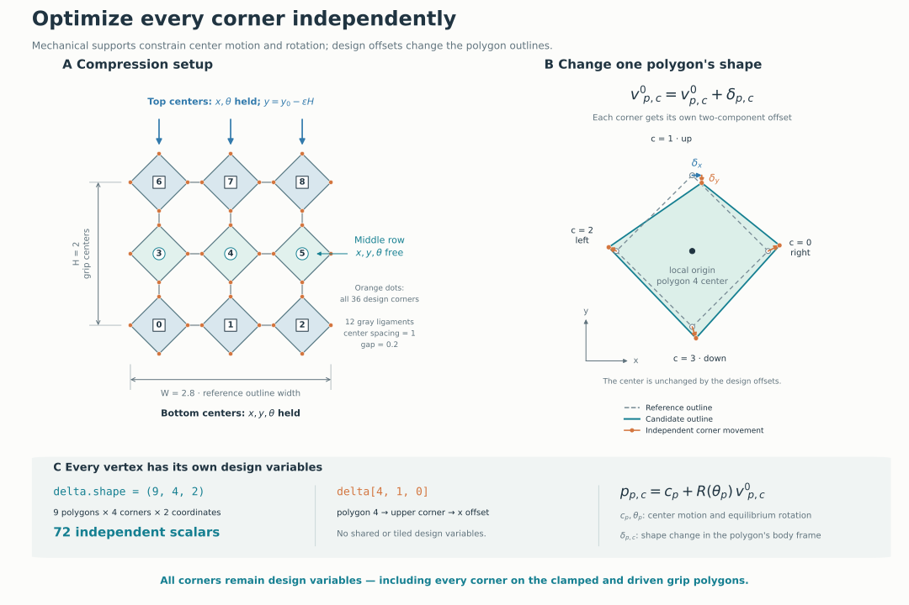

# Worked examples

Install the package from the repository root with
`python -m pip install -e ".[notebook]"`. Select that environment as your
notebook kernel. Each notebook contains explanatory comments, executable setup,
and saved figures. The Python scripts run the same studies without Jupyter.

| Tutorial | What you learn | Python script |
| --- | --- | --- |
| [01 — Shape and stress–strain matching](01_optimize_square_grid.ipynb) | Follow the complete workflow; change local vertex offsets; distinguish inner equilibrium from outer design optimization | [optimize_square_grid.py](optimize_square_grid.py) |
| [02 — Boundary conditions](02_boundary_conditions.ipynb) | Read polygon IDs and x/y/angle masks; compare clamped and sliding grips; fix one coordinate; prescribe a nonzero angle; impose shear | [boundary_conditions.py](boundary_conditions.py) |
| [03 — Different objectives](03_optimization_objectives.ipynb) | Target secant stiffness or equalize support forces; impose a minimum load; define maximization and weighted costs | [optimize_objectives.py](optimize_objectives.py) |
| [04 — Spring constants](04_optimize_spring_constants.ipynb) | Hold shape fixed and optimize shared, grouped, or per-bond stiffness variables; fit axial and bending constants | [optimize_spring_constants.py](optimize_spring_constants.py) |
| [05 — Independent vertices](05_optimize_all_vertices.ipynb) | Optimize every x/y vertex coordinate on a square grid; use a `(polygon, corner, coordinate)` parameter tensor; distinguish shape changes from mechanical motion | [optimize_all_vertices.py](optimize_all_vertices.py) |

The independent [Verlet script](verlet_compression.py) demonstrates dynamic
compression. Tutorial 01 also shows how to switch from equilibrium solves to
time integration.

Two additional scripts reuse the same geometry, solvers, and objectives:

- [Video export](make_video.py): write GIF or MP4 from computed states. Install
  `".[video]"`; MP4 also uses the system `ffmpeg` executable.
- [NLopt optimization](optimize_with_nlopt.py): fit the stress curve with NLopt
  SLSQP or MMA and the same JAX derivatives. Install `".[nlopt]"`.

## Fixing one degree of freedom

A state is an `(n_polygons, 3)` array; columns are **x, y, angle**. Geometry
contains the elastic rest state. Boundary conditions contain prescribed
coordinate values, which can differ from that rest state.

```python
import numpy as np
from rotating_polygons import BoundaryConditions, compression_boundary

base = compression_boundary(geometry, clamp_horizontal=False, clamp_rotations=False)
fixed = np.array(base.fixed_mask, copy=True)  # Copy so the original boundary is unchanged.
target = np.array(base.reference_state, copy=True)  # Coordinates to impose where fixed is True.
direction = np.array(base.strain_direction, copy=True)  # Displacement per unit loading parameter.

polygon_id, coordinate = 4, 2  # Polygon 4, angle; choose 0 for x or 1 for y.
fixed[polygon_id, coordinate] = True  # Prescribe only this coordinate.
target[polygon_id, coordinate] = 0.0  # Fix its value; angles are in radians.
direction[polygon_id, coordinate] = 0.0  # Zero means stationary, even during loading.

boundary = BoundaryConditions(target, fixed, direction, base.height, base.width)
```

The other two coordinates of polygon 4 retain their previous free/fixed status.
To release a coordinate, set its mask to `False` and its drive to zero.
Construct a new solver using the new boundary; a previously constructed solver
still uses the boundary supplied to it. Tutorial 02 plots all masks and checks
every prescribed coordinate throughout the simulation.

## Three different meanings of “parameters”

| Kind | Example | What changes it? |
| --- | --- | --- |
| Mechanical state | Polygon center positions and angles, `q` | The inner equilibrium solver or the time integrator |
| Design variables | Vertex offsets, `log(k_l)`, `log(k_theta)` | The outer `minimize_design` call |
| Numerical settings | Equilibrium tolerance, iteration limits, optimizer tolerance | You, before running the calculation |

`QuasistaticOptions(tolerance=1e-9, max_iterations=500)` controls each
equilibrium's force/torque residual and inner iteration limit.
`minimize_design(..., maxiter=60, tol=1e-10)` controls the outer SLSQP design
optimization. Neither setting selects the physical design variables.

The **initial parameter array and its mapping** select those variables.
In tutorial 01, two entries move two vertices on every polygon. In tutorial 04, one or three
entries become physical spring constants through `exp`. A coefficient written
as a literal constant in that map remains fixed. Bounds and constraints must
refer to the same optimizer coordinates: bounds on `log(k)` must be logarithms
of the physical stiffness limits.

## Give every vertex its own parameters

Tutorial 05 uses a 3×3 grid with **72 independent scalar offsets**:
9 polygons × 4 corners × 2 coordinates. The corners are ordered right, up,
left, down in each polygon's local frame. `offsets[4, 1, 0]`, for example,
changes only the x coordinate of polygon 4's upper corner.

```python
initial_offsets = jnp.zeros((geometry.n_polygons, 4, 2))


def vertices_from_parameters(offsets):
    # Flatten the polygon/corner axes to match the library's vertex ordering.
    return geometry.vertices + offsets.reshape((-1, 2))
```

Every entry is independent. This includes corners on the grip polygons:
fixing a polygon's mechanical x/y/angle does not freeze its design vertices.
The inner solver translates and rotates rigid polygons; the outer optimizer
changes their reference shapes and reinitializes the hinge rest geometry.



The [drawing script](draw_vertex_design.py) generates the diagram as SVG and
PNG. The notebook walks through its labels and plots initial and optimized
shapes at the same unloaded positions, so shape changes are visible separately
from compression.

A single stress–strain curve does not uniquely determine 72 coordinates.
Some outline corners have no active hinge response in this loading regime.
The example therefore adds a small, adjustable penalty on squared offsets to
prefer smaller changes. It reports the stress error separately from that
penalty; it does not claim to recover a unique target geometry.

## Changing an objective

An objective accepts the design variables and returns one JAX scalar. It
initializes the candidate model, solves it, measures the response, and computes
a cost. A target secant stiffness can use
`((stress / strain - target) / target)**2`; a maximum-stiffness design minimizes
the **negative** normalized stiffness.

Force uniformity uses a normalized variance. Without a minimum-load
restriction, an unloaded design could appear ideal, so tutorial 03 explicitly
requires a nonzero total reaction. Its weighted-objective example first makes
each component dimensionless so the weights have an interpretable role.

## Changing which spring constants are optimized

Use `MechanicalParameters` with `make_parameterized_potential` for active
material coefficients. Pass the complete object to **both** the simulator and
the measurement function. This makes JAX's implicit equilibrium derivatives
account for stiffness changes. Keep `PotentialParameters` / `make_potential`
for coefficients that stay fixed.

The stiffness fields accept scalars or arrays of length `geometry.n_bonds`:

```python
# In a material mapping function, with positive stiffness values from exp(z):
stretching = jnp.exp(z[0])  # One shared axial stiffness.
bending = jnp.exp(z)  # One independent bending value per bond if z has n_bonds entries.
bending = jnp.exp(z)[group_ids]  # Fewer variables, repeated according to a group map.
```

The notebook executes shared axial, grouped axial, and shared bending fits.
It also shows the per-bond representation. More variables require sufficiently
informative observations; a single total force curve generally cannot identify
every hinge independently. The [module guide](../docs/modules.md) additionally
shows joint shape and material optimization with a dictionary of variables.

## Run the scripts

From the repository root:

```bash
python examples/optimize_square_grid.py --output outputs
python examples/boundary_conditions.py --output outputs/boundaries
python examples/optimize_objectives.py --objective all --output outputs
python examples/optimize_spring_constants.py --parameterization all --output outputs
python examples/optimize_all_vertices.py --output outputs
python examples/draw_vertex_design.py --output docs/assets
python examples/optimize_with_nlopt.py --output outputs
python examples/make_video.py --output outputs/compression.gif
python examples/verlet_compression.py --output outputs
```

Each script saves figures and numerical results, checks convergence, and uses
the finite-hinge model. The targets are synthetic so the fitting tasks are
reproducible; they do not constitute experimental material identification.
